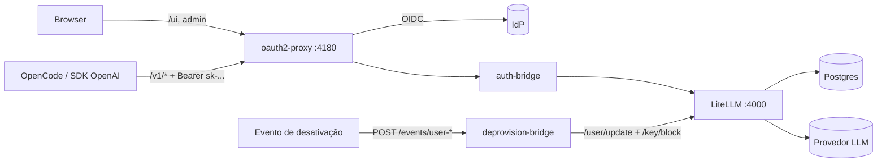
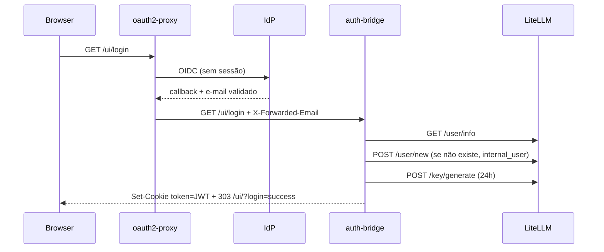
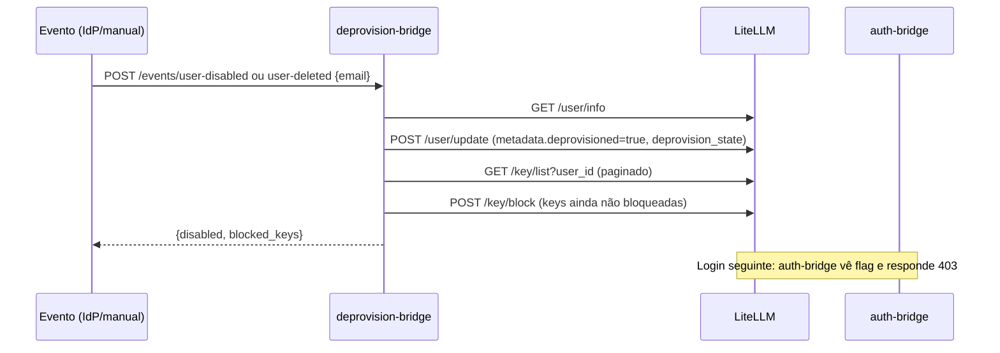

# Apresentação: SSO no LiteLLM Community via oauth2-proxy + auth-bridge

Estrutura de slides. Cada slide: objetivo, conteúdo, fonte no repo. Duração sugerida: 30-40 min + Q&A.

> O deck apresentado é uma versão condensada (15 slides, orientada a negócio, com o detalhe técnico nas notas do apresentador). Este documento é o roteiro técnico completo. O desprovisionamento descrito aqui segue o comportamento atual do `deprovision-bridge` (três eventos, sem alterar `max_budget`).

Legenda de confiança: **[repo]** = verificado no código deste PoC. **[validar]** = afirmação sobre o LiteLLM Enterprise/Community que deve ser conferida na doc/pricing vigente antes de apresentar.

---

## Bloco 1 - Contexto (5 min)

### Slide 1 - Título
- "AI Gateway com SSO sem licença Enterprise: LiteLLM Community + oauth2-proxy"
- Subtítulo: PoC validado localmente (docker compose), Google como IdP, trocável por Entra ID.

### Slide 2 - Problema
- Queremos gateway único de LLM (OpenAI-compatible) para devs/ferramentas (OpenCode, SDKs).
- Requisitos: login corporativo (SSO), cada pessoa com sua virtual key, rastreio de spend por usuário, revogação quando a pessoa sai.
- SSO nativo do LiteLLM + gestão avançada de usuários é feature paga. Pergunta do PoC: dá para entregar o essencial só com open source?

### Slide 3 - Proposta em uma frase
- Colocar o SSO **na frente** do LiteLLM (oauth2-proxy) e usar uma **ponte própria** (auth-bridge) para traduzir "usuário autenticado" em "sessão válida do LiteLLM", usando só a Admin API pública do LiteLLM.

---

## Bloco 2 - Arquitetura (7 min)

### Slide 4 - Visão geral
Diagrama (mermaid, fonte: README.md):

### Slide 5 - Componentes e responsabilidades [repo]
| Componente | Responsabilidade |
|---|---|
| oauth2-proxy | Único ponto exposto. OIDC com IdP para UI/admin. `/v1/*` liberado de sessão (`SKIP_AUTH_ROUTES`) |
| auth-bridge | Converte identidade SSO em sessão LiteLLM; guarda `/v1/*`; proxy em streaming |
| LiteLLM (community) | Gateway, virtual keys, budget, logs |
| Postgres | Usuários, keys, spend (obrigatório para login de UI) |
| deprovision-bridge | Desativa usuário e bloqueia keys |

### Slide 6 - Duas portas de entrada, dois mecanismos de auth [repo]
| Rota | Quem autentica |
|---|---|
| `/ui`, `/key/*`, `/user/*` | oauth2-proxy (sessão IdP) |
| `/v1/*` | auth-bridge (exige `Bearer sk-`) + LiteLLM (valida key) |
- Mensagem: humano entra por SSO; máquina/ferramenta entra por virtual key. Identidade única = e-mail (`user_id` = e-mail).

---

## Bloco 3 - Processo de criação de usuário (JIT) (6 min)

### Slide 7 - Fluxo de primeiro login [repo: `auth-bridge/app.py`]

### Slide 8 - Detalhes que importam
- Provisionamento **just-in-time**: usuário nasce no primeiro login, role fixa `internal_user`, `auto_create_key: false`.
- `/key/generate` **não cria** usuário. Sem registro em `LiteLLM_UserTable` o dono vira `role=unknown` e a UI bloqueia criação de key. Por isso `/user/new` antes (achado do PoC).
- Header correto do oauth2-proxy em modo reverse-proxy: `X-Forwarded-Email` (não `X-Auth-Request-Email`).
- Slide de "lições aprendidas" (ver Bloco 7).

---

## Bloco 4 - Armazenamento de credenciais (7 min)

### Slide 9 - Mapa de credenciais e onde vivem [repo]
| Credencial | Onde fica | Observação |
|---|---|---|
| Client ID/Secret do IdP | `.env` -> env do oauth2-proxy | Produção: secret manager |
| Cookie secret do oauth2-proxy | `.env` | Assina/encripta sessão `_oauth2_proxy` |
| `LITELLM_MASTER_KEY` | `.env` -> litellm, auth-bridge, deprovision-bridge | Chave mais crítica: admin total **e** chave de assinatura do JWT de UI |
| Chave do provedor (OpenAI) | `.env` -> litellm (`os.environ/OPENAI_API_KEY`) | Nunca chega ao cliente |
| Virtual keys (`sk-...`) | Postgres (`LiteLLM_VerificationToken`), valor em claro só na criação | LiteLLM guarda hash; usuário vê uma vez |
| Sessão de UI | Cookie `token` = JWT HS256 assinado com master key (24h) | `httponly=False`, `secure=False` no PoC |
| Sessão SSO | Cookie `_oauth2_proxy` (stateless, assinado) | Logout precisa derrubar os dois (`PROXY_LOGOUT_URL`) |
| Senha Postgres | compose (fixa no PoC) | Banco sem porta publicada |

### Slide 10 - Dois tipos de key, dois ciclos de vida [repo]
- **Key de UI**: gerada pelo auth-bridge a cada login, 24h, vive embutida no JWT da sessão. Não é para uso em ferramenta.
- **Key de uso (OpenCode/SDK)**: criada pelo próprio usuário em *Virtual Keys* na UI; guardada em env var local (`LITELLM_API_KEY`).
- Provedor LLM: cliente só conhece a virtual key; a chave real do provedor fica no servidor.

### Slide 11 - Riscos de credencial a declarar [repo + análise]
- Master key vaza = admin total + forja de sessão de UI de qualquer usuário (JWT assinado com ela).
- Key de UI nova a cada login acumula keys (PoC; produção: reaproveitar/revogar).
- Cookie sem `httponly`/`secure`, sem TLS (PoC).
- Mitigações de produção: secret manager, rotação da master key, TLS, cookie secure/httponly, expiração obrigatória nas keys.

---

## Bloco 5 - Sincronização de dados (5 min)

### Slide 12 - Fonte da verdade e direção do sync
- IdP é a fonte de identidade; LiteLLM/Postgres é a fonte de **autorização e consumo**.
- Sincronização hoje é **pull-on-login (JIT)**, não push/SCIM. [repo]

| Dado | Origem | Quando sincroniza |
|---|---|---|
| E-mail / identidade | IdP (via oauth2-proxy) | A cada login (`/user/info` idempotente) |
| `user_id`, `user_email`, role | auth-bridge | Criação (1º login) |
| Estado "desativado" | deprovision-bridge | Por evento |
| Spend, logs, keys | LiteLLM/Postgres | Contínuo, local |

### Slide 13 - O que NÃO sincroniza (gap honesto)
- Mudança de nome/e-mail no IdP não atualiza o usuário existente.
- Grupos/cargos do IdP não viram team/role no LiteLLM.
- Usuário removido do IdP **continua ativo** até alguém disparar o evento de desativação.
- Reativação é manual (ver slide 15).

---

## Bloco 6 - Processo de exclusão (desprovisionamento) (6 min)

### Slide 14 - Por que "desabilitar" em vez de "excluir" [repo: `deprovision-bridge/app.py`]
- `/user/delete` apagaria o vínculo com histórico de spend/logs (`user_id`). Auditoria/FinOps perde rastro.
- `LiteLLM_UserTable` não tem flag de bloqueio (só as keys têm). O bridge usa flag no metadata + bloqueio de keys; o `max_budget` não é alterado (é um teto do usuário, não saldo reservado).

### Slide 15 - Fluxo

- Ordem proposital: desabilita usuário **antes** de listar keys; login concorrente já é recusado e não gera key fora da lista.
- Duas barreiras: keys bloqueadas e login de UI recusado (403). O budget não é tocado.
- Dois casos: `user-disabled` (suspensão reversível, ex.: férias) e `user-deleted` (desligamento; grava `budget_snapshot` para o gestor redistribuir).
- Reativar: `user-enabled` desbloqueia só as keys que o bridge bloqueou (`blocked_key_hashes`) e remove a flag. Em usuário desligado retorna 409.

### Slide 16 - Do PoC para produção
- Hoje o evento é um `curl` manual. Produção: Microsoft Graph change notification -> worker -> endpoint autenticado (segredo compartilhado/assinatura).
- Endpoint `:8081` exposto sem auth só no PoC.
- Pendências: idempotência/retry, fila, reconciliação periódica (job que compara lista do IdP com LiteLLM).

---

## Bloco 7 - O que fica de fora: RBAC e Enterprise (8 min)

> Aviso de rigor: lista de features Enterprise **[validar]** contra a doc/pricing atual do LiteLLM antes da apresentação. Os limites do PoC abaixo são **[repo]**.

### Slide 17 - O que o PoC entrega vs. o que não entrega
| Capacidade | Este PoC (community + bridge) | Enterprise **[validar]** |
|---|---|---|
| Login SSO na Admin UI | Sim (via oauth2-proxy + JWT forjado no formato nativo) | SSO nativo |
| Provisionamento de usuário | JIT no 1º login | SCIM / sync de IdP |
| Virtual keys por usuário, budget, spend | Sim (feature community) | Sim |
| Desativação de usuário | Via evento + bridge próprio | Via SCIM/IdP |
| Papéis | **Um só: `internal_user`** | RBAC com roles/permissões finas, custom roles |
| Admin via SSO | Não (admin só pela master key / ajuste manual) | Mapeado por grupo/claim |
| Grupos do IdP -> teams | Não | Sim (group/claim mapping) |
| Auth JWT/claims por request | Não | JWT auth com mapeamento de role/team |
| Audit log | Só logs dos containers | Audit logs dedicados |
| Controles por team (logging, guardrails, restrições) | Limitado | Granular |
| Suporte/SLA | Comunidade | Comercial |

### Slide 18 - Lacunas de RBAC concretas neste desenho [repo]
- Todos os usuários nascem `internal_user`; promover a admin = ação manual fora do fluxo SSO.
- Sem noção de time/projeto vindo do IdP: segmentação de modelos/budget por grupo é manual (por key/team criados à mão).
- Wildcard `*` em `config.yaml` libera qualquer modelo; restrição precisa ser por key/team, manualmente.
- `premium_user: False` no JWT: UI exibe só o que é community.
- Autorização é decidida **no login**, não por request: mudar role no IdP só vale no próximo login (e hoje nem isso).

### Slide 19 - Riscos e custo de manter a ponte
- A ponte replica internals do LiteLLM (`ReturnedUITokenObject`, assinatura HS256 com master key). Upgrade do LiteLLM pode quebrar o formato do cookie.
- Código próprio em caminho de autenticação = superfície de segurança sob nossa responsabilidade.
- `/v1/*` fora do SSO: segurança depende 100% da virtual key; uma key vazada funciona até ser bloqueada.
- Imagens com tag móvel (`main-stable`, `latest`): fixar versão/digest.

---

## Bloco 8 - Fechamento (4 min)

### Slide 20 - Quando community+bridge basta, quando migrar
- Basta: equipe pequena, papel único, poucos grupos, offboarding por evento simples.
- Migrar para Enterprise: necessidade de RBAC por grupo, SCIM, audit log, SLA, ou se manter a ponte custar mais que a licença.
- Critério de decisão: custo de licença vs. custo de manter ponte + risco de quebra em upgrade.

### Slide 21 - Roadmap para produção
1. Entra Entra ID no lugar do Google (`OAUTH2_PROXY_PROVIDER`, `EMAIL_DOMAINS` restrito).
2. TLS + cookie `secure`/`httponly`; secret manager; fixar imagens.
3. Reaproveitar/revogar key de UI (evitar acúmulo).
4. Desprovisionamento real: Graph change notification + endpoint autenticado + reconciliação.
5. Mapeamento mínimo de grupo -> role/team no auth-bridge (se quiser aproximar RBAC).
6. Lista explícita de modelos; rate limit/WAF.

### Slide 22 - Perguntas / demo
- Demo sugerida (3 min): login SSO -> criar key -> chamada em `/v1/models` -> `curl` de desativação -> mesma key recusada + login 403.

---

## Apêndice

- A1: Achados que corrigiram a hipótese inicial (README.md, seção homônima).
- A2: Simplificações deliberadas do PoC (README.md).
- A3: Comandos de demo (README.md: "Testar o fluxo de login" e "Desprovisionamento de usuário").
- A4: Fontes no repo: `auth-bridge/app.py`, `deprovision-bridge/app.py`, `docker-compose.yml`, `litellm/config.yaml`, `litellm-sso-opencode.md`.
